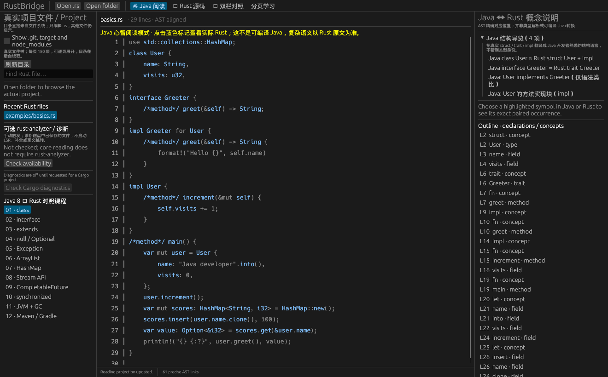

# RustBridge 🦀☕

**一个为 Java 8 开发者设计的极轻量 Rust 学习 IDE。** / A tiny native Rust IDE for Java developers learning Rust.

RustBridge is written in Rust (egui/eframe + Tree-sitter). There is no JVM, Electron, Chromium, or Node.js runtime.

> **Important:** The Java view is an educational *mental model*, not compilable Java, a full transpiler, or a proof of semantic equivalence. The real `.rs` file is the only editable source of truth.



## What works — v0.5

- **Java View (default):** open a real `.rs` file and read a conservative AST-based Java-inspired projection.
- **Linked Compare:** left Java projection, right actual Rust; click a highlighted method, field, type or keyword in **either** pane to select its exact corresponding AST token occurrence, highlight both, and jump to the same source location.
- **Semantic guide:** see 1-based Rust / Java line and Unicode-aware column, original/projection token, and Java-to-Rust conceptual explanation.
- **Rust Source:** edit the actual file with syntax colors for keywords, line/block comments and Rust string/character literals, physical line numbers, find-next and native undo/redo shortcuts. Clicking a token shows its explanation; jumping from the guide selects that token in the editor. Save with Ctrl+S.
- **Linked scroll:** optionally follow scrolling across compare panes, including wheel and scrollbar changes.
- **Real filesystem:** open `.rs` files and explore the actual Cargo project tree; do not hide, replace or synthesize source directories.
- **Project navigation:** search real Rust filenames on a cancellable background worker, reopen the eight most recently opened Rust files, show why `.git`, `target` and `node_modules` are excluded by default, and opt in to see them when needed.
- **Safe editing:** saving refuses to overwrite a file changed or removed outside RustBridge; a visible reload action restores the disk copy, while switching files and closing with edits require an explicit save, discard or cancel choice.
- **Responsive projection:** edits are debounced and projected on one on-demand worker. Older results are discarded, so an outdated source map is never applied to newer text.
- **Learn:** 12 paged Java 8 ↔ Rust language concepts, with short code examples.
- **Conservative syntax handling:** Tree-sitter AST recognition, no automatic macro expansion, warnings on malformed syntax; unrecognized Rust syntax stays Rust.
- **Large-file support:** visible-row rendering and per-line indexed AST links, without scanning the entire AST for every visible line.

## v0.5 · Java8-to-Rust learning and native release

RustBridge v0.5 keeps real Rust files as the only editable source. Java code on screen is a read-only conceptual projection, not an executable transpilation.

- **Crash recovery:** private local journal of dirty Rust source with a full saved baseline; on restart, restore into the editor only if the disk still matches that baseline. Otherwise export a non-overwriting recovery copy.
- **Session continuity:** resume real project/file, reading mode, lesson progress and Rust cursor position.
- **Interactive learning:** twelve short Java8→Rust quizzes; incorrect answers have conceptual explanations, and progress is stored privately.
- **Optional rust-analyzer LSP:** real JSON-RPC hover, completion, same/cross-file definition locations, UTF-16 coordinates and cancellable server lifecycle. Enable explicitly; semantic indexing may take time.
- **User-authorized Cargo:** explicit trust approval before cargo check/test/run (including potentially unsafe build.rs/project code), bounded subprocess output, timeouts, cancellation and clickable rustc diagnostics.
- **Sliding virtual source window:** a global line slider, wheel-edge rebase and keyboard navigation across a bounded 240-line moving editor. This is not a full rope-based text editor.
- **Source safety:** per-path cooperative Unix lock, exclusive Windows open handles, separate read/save workers with cancelable reads and slow-I/O status. Accepted saves never silently exit on a close request.
- **Three native platforms:** Debian .deb, macOS .app zip, Windows portable zip and NSIS user installer. Mac/Windows write through the existing open file handle plus a private recovery backup, **not** the same power-loss atomic rename as Linux. Windows/macOS builds are unsigned/unnotarized.
- **Verification:** Linux real X11 keyboard, source-save/crash-restart checks, real Ubuntu GNOME Wayland window probe, native Windows/macOS CI build/test/package, CPU/RSS/fd budgets and scheduled endurance. See the v0.5 integrated 13-workstream report in docs/v0.5-integrated-13.md.

Keyboard: Ctrl+1/2/3/4 switches Java/Rust/Compare/Lessons; Ctrl+PageDown/Up traverses large source windows; Ctrl+S saves the actual Rust source.

## v0.4 safety, UX and Linux release

- **Safer Linux saving:** reject read-only source; preserve verified file mode, owner and readable extended attributes (including ACL/security labels) or refuse to save. Distinguish committed-but-durability-uncertain status after a successful rename.
- **Non-blocking source I/O:** read/save on a background worker with latest-open cancellation, 32 MiB safety cap and nonblocking Unix special-file detection; the window remains responsive during regular file I/O.
- **Reliable external change awareness:** reusable background observer compares ctime/inode/device/mtime/size, detecting same-sized changes with restored mtime. Real directory contents revalidate automatically when viewed.
- **Mixed newline editing:** prevent standalone CR, LF and CRLF from merging across an edit seam; deterministic fuzz regressions cover Unicode and mixed line endings.
- **Learning navigation:** an optional AST-only same-name declaration search over actual Rust files; candidates are NOT resolved definitions, and clicking opens the source location. Keyboard access: Ctrl+1 (Java), Ctrl+2 (Rust), Ctrl+3 (Compare), Ctrl+4 (Lessons); for large Rust files Ctrl+PageDown / Ctrl+PageUp navigates editor pages.
- **Native Linux package + CI:** `scripts/package-deb.sh` creates a Debian package; CI builds the Release binary once, tests real keyboard-based X11/Xvfb GUI saves and source resources, extracts and tests the packaged binary.
- **Release / acceptance:** see [the v0.4 hardening and acceptance report](docs/v0.4-integrated-acceptance.md) for exact scope and remaining limitations. No bundled system fonts.

## v0.3 safety and performance changes

- Prevent editor panic on Chinese or emoji nested block comments; correct search-next byte offsets; preserve custom `Option` / `Vec` type names instead of blindly renaming them.
- Atomic save uses a temporary file in the same directory, fsync and rename; keeps original on staging failures and refuses symlink/hardlink overwrite, external change and inode conflicts. This is **not** a transactional compare-and-swap against uncooperative concurrent editors: a final comparison-to-rename race is still possible.
- Real project directory listing is lazy and asynchronous; entries remain real filesystem paths. Show the complete directory via expandable pages, without silently capping discovery at 180 entries.
- Tree-sitter is reused incrementally after edits and aborted/superseded work is discarded. UI uses cached line indices; Rust files >= 512 KiB use a 240-line paged editor to avoid constructing a full-file text layout every repaint. CRLF is normalized only in the widget and patched back to original source bytes on edits; unchanged mixed line endings stay intact.
- Optional rust-analyzer checks now carry their project identity, stop on switch, cancel their process group and enforce timeouts. Diagnostics operate on saved disk source, not unsaved buffers.
- Chinese beginner explanations, Java structure summaries and a system-font-only CJK fallback improve readability without bundling font files. Unsupported syntax still remains actual Rust.
- Run a local file/folder from the command line: `cargo run -- path/to/real/file.rs` or `cargo run -- /path/to/project`.

## Run locally (Ubuntu/Linux)

Install the Rust toolchain via https://rustup.rs and native X11 / Wayland graphics development libraries required by eframe. On Ubuntu/Debian:

```bash
sudo apt-get install -y build-essential pkg-config libxkbcommon-dev libxkbcommon-x11-0 libwayland-dev libx11-dev libx11-xcb-dev libgl1-mesa-dev
git clone https://github.com/code5m/rustbridge.git
cd rustbridge
cargo run
```

Then choose **Open folder** for a real Cargo project or **Open .rs** for a single Rust file. To directly open a known file run `cargo run -- /absolute/path/example.rs`. The Java view opens by default. Click the blue symbols to enter paired comparison. Switch to **Rust Source** when you want to edit and save the original file.

## Validate

```bash
cargo fmt --check
cargo check --all-targets
cargo test --all-targets
cargo test integration_real_rust_analyzer_hover_completion_definition -- --ignored --nocapture
cargo test integration_real_cargo_check_streams_clickable_diagnostics -- --ignored --nocapture
cargo test integration_real_cargo_test_and_run_execute_only_when_requested -- --ignored --nocapture
cargo clippy --all-targets -- -D warnings
cargo build --release
xvfb-run -a -s '-screen 0 1440x900x24' bash tests/gui-smoke.sh ./target/release/rustbridge
xvfb-run -a -s '-screen 0 1440x900x24' bash tests/recovery-smoke.sh ./target/release/rustbridge
xvfb-run -a -s '-screen 0 1440x900x24' bash tests/resource-smoke.sh ./target/release/rustbridge
xvfb-run -a -s '-screen 0 1440x900x24' bash tests/soak.sh ./target/release/rustbridge 180
bash scripts/package-deb.sh --skip-build
```

Native package commands are OS-specific: on macOS run bash scripts/package-macos.sh --skip-build; in Windows PowerShell run ./scripts/package-windows.ps1 --skip-build. The native CI jobs additionally build the NSIS installer and validate each platform package.

## Performance and limits

Measured observations, machine details and the exact benchmark method are in
[docs/performance-baseline.md](docs/performance-baseline.md). The v0.5 Linux X11/Xvfb acceptance includes actual keyboard saves, CRLF-preserving
wheel/keyboard navigation across the virtual editor window, SIGKILL recovery,
idle CPU/RSS/FD gates and a 3-minute interactive soak. A native GNOME Wayland
window protocol probe also passes. See docs/performance-baseline.md for methods
and exact measurements. These are workstation observations, not a universal
multi-platform or 24-hour endurance guarantee.

File-name search is bounded to 100 matches and depth 12. The real directory tree
is scanned on a worker and pages entries in groups of 180; all meaningful top-level
directories are initially exposed, and users can expand more entries without a
hidden total cap. Symlinks are displayed, not recursively followed; traversal
depth 24 is reported explicitly. The source editor uses 240-line paging on files
larger than or equal to 512 KiB, with a sliding window and global line slider; the original Rust document remains intact.

## Architecture

| Path | Responsibility |
| --- | --- |
| `src/parser.rs` | Tree-sitter syntax tree, AST occurrence anchors, UTF-8-safe source↔projection span mapping |
| `src/code_view.rs` | Virtualized read-only line renderer and clickable token spans |
| `src/main.rs` | App state and native UI orchestration, view navigation and lifecycle |
| `src/editor_core.rs` / `src/editor_ui.rs` / `src/editor_eol.rs` | UTF-8 safe syntax coloring, bounded pages, CRLF-safe editor buffer mapping |
| `src/file_tree.rs` / `src/file_search_worker.rs` | Lazy real-directory index and cancellable filename search |
| `src/projection_worker.rs` | Reusable incremental Tree-sitter parser and revision cancellation |
| `src/safe_save.rs` | Staged atomic writes and external-editor conflict checks |
| `src/analyzer.rs` | Opt-in process-scoped rust-analyzer diagnostic checks |
| `src/file_watch.rs` | Reusable background file identity/ctime/mtime monitoring |
| `src/document_io.rs` | Async source open/save, generation-based cancellation and file limits |
| `src/symbol_search.rs` | Bounded AST-only declaration candidate search (not a resolver) |
| src/lessons.rs / src/lesson_quiz.rs | 12 Java↔Rust lessons, quizzes and mastery progress |
| src/persistence.rs | Crash journals, atomic session snapshots and private recovery export |
| src/lsp.rs | Opt-in rust-analyzer JSON-RPC client and UTF-16 position mapping |
| src/cargo_runner.rs | User-approved Cargo check/test/run, cancellation and compiler diagnostics |
| src/line_index.rs | Incremental UTF-8 source line-offset maintenance |
| scripts/package-deb.sh / scripts/package-macos.sh / scripts/package-windows.ps1 | Native Linux/macOS/Windows packages |
| tests/*.sh | Real GUI save, crash recovery, CPU/RSS/fd and endurance smoke |
| `src/ui_fonts.rs` | OS font fallback for Chinese glyphs (no bundled font files) |
| `examples/projection_probe.rs` | Release projection microbenchmark of full vs incremental processing |
| `examples/basics.rs` | Self-contained example |
| `AGENTS.md` | Design principles, contracts, acceptance criteria |

## Precision and scope

**Precise** means the same *syntactic occurrence* has byte-accurate spans in both views. It does **not** mean resolved cross-file definition lookup (only syntax-based same-name candidates), type inference, trait resolution, lifetime checking, or macro expansion. Analogies such as `Option` ≈ `Optional` and `Vec` ≈ `ArrayList` are **explanatory hints only**: without a real type resolver, Rust identifiers are retained unchanged so a user-defined type cannot be misrepresented. Always check the original Rust and explanatory panel.

Text transforms never reorder source statements or insert/remove newlines, preserving line correspondence. Span maps and Unicode/CRLF handling are unit-tested. Original Rust source is not modified by Java View or Compare.

## Honest limits after v0.5

- **Semantics:** LSP is opt-in and may need indexing and Cargo configuration beyond default safe options. Java projection is not a type-resolved translator; Rust code executes only with explicit Cargo authorization.
- **Source correctness:** cooperating RustBridge writers are serialized, but uncooperative editors can still race final Linux rename. Remote filesystem system calls can block despite worker deadlines checked between chunks.
- **OS differences:** macOS and Windows preserve the file's metadata through its existing open handle and private rollback backup, not a power-loss-atomic rename. Linux has real automated X11 interaction; the Wayland window probe does not substitute for human usability acceptance.
- **Distribution:** Windows/macOS artifacts are unsigned. No debugger, general plugin marketplace or complete general-purpose IDE replacement.
- **Performance:** active software rendering can use substantial CPU even if idle use is low. 24-hour memory stability and all-platform IME remain separate release gates.

MIT licensed. See [CHANGELOG.md](CHANGELOG.md).
