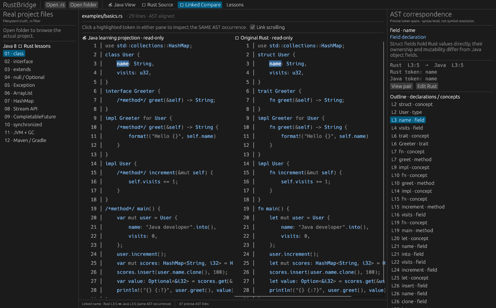

# RustBridge 🦀☕

**一个为 Java 8 开发者设计的极轻量 Rust 学习 IDE。** / A tiny native Rust IDE for Java developers learning Rust.

RustBridge is written in Rust (egui/eframe + Tree-sitter). There is no JVM, Electron, Chromium, or Node.js runtime.

> **Important:** The Java view is an educational *mental model*, not compilable Java, a full transpiler, or a proof of semantic equivalence. The real `.rs` file is the only editable source of truth.



## What works — v0.2

- **Java View (default):** open a real `.rs` file and read a conservative AST-based Java-inspired projection.
- **Linked Compare:** left Java projection, right actual Rust; click a highlighted method, field, type or keyword in **either** pane to select its exact corresponding AST token occurrence, highlight both, and jump to the same source location.
- **Semantic guide:** see 1-based Rust / Java line and Unicode-aware column, original/projection token, and Java-to-Rust conceptual explanation.
- **Rust Source:** edit the actual file with syntax colors, physical line numbers, find-next and native undo/redo shortcuts. Clicking a token shows its explanation; jumping from the guide selects that token in the editor. Save with Ctrl+S.
- **Linked scroll:** optionally follow scrolling across compare panes, including wheel and scrollbar changes.
- **Real filesystem:** open `.rs` files and explore the actual Cargo project tree; do not hide, replace or synthesize source directories.
- **Project navigation:** search real Rust filenames on a cancellable background worker, reopen the eight most recently opened Rust files, show why `.git`, `target` and `node_modules` are excluded by default, and opt in to see them when needed.
- **Safe editing:** saving refuses to overwrite a file changed or removed outside RustBridge; switching files and closing with edits require an explicit save, discard or cancel choice.
- **Responsive projection:** edits are debounced and projected on one on-demand worker. Older results are discarded, so an outdated source map is never applied to newer text.
- **Learn:** 12 paged Java 8 ↔ Rust language concepts, with short code examples.
- **Conservative syntax handling:** Tree-sitter AST recognition, no automatic macro expansion, warnings on malformed syntax; unrecognized Rust syntax stays Rust.
- **Large-file support:** visible-row rendering and per-line indexed AST links, without scanning the entire AST for every visible line.

## Run locally (Ubuntu/Linux)

Install the Rust toolchain via https://rustup.rs and native X11 / Wayland graphics development libraries required by eframe. On Ubuntu/Debian:

```bash
sudo apt-get install -y build-essential pkg-config libxkbcommon-dev libwayland-dev libx11-dev libx11-xcb-dev libgl1-mesa-dev
git clone https://github.com/code5m/rustbridge.git
cd rustbridge
cargo run
```

Then choose **Open folder** for a real Cargo project or **Open .rs** for a single Rust file. The Java view opens by default. Click the blue symbols to enter paired comparison. Switch to **Rust Source** when you want to edit and save the original file.

## Validate

```bash
cargo fmt --check
cargo check --all-targets
cargo test --all-targets
cargo clippy --all-targets -- -D warnings
```

## Performance and limits

Measured observations, machine details and the exact benchmark method are in
[docs/performance-baseline.md](docs/performance-baseline.md). They deliberately
separate real measurements from unverified claims: the native window was started on
Linux, but the available desktop automation could not attach to it, so the document
does not claim a completed visual interaction review.

File-name search is bounded to 100 matching Rust files and depth 12. The tree is
bounded to 180 entries per expanded directory and depth 8. These bounds keep a large
project from freezing the UI; a fuller project index remains future work.

## Architecture

| Path | Responsibility |
| --- | --- |
| `src/parser.rs` | Tree-sitter syntax tree, AST occurrence anchors, UTF-8-safe source↔projection span mapping |
| `src/code_view.rs` | Virtualized read-only line renderer and clickable token spans |
| `src/main.rs` | Native GUI, file I/O, selection/navigation, scroll linking, Rust editing |
| `src/lessons.rs` | 12 introductory Java↔Rust lessons |
| `examples/basics.rs` | Self-contained example |
| `AGENTS.md` | Design principles, contracts, acceptance criteria |

## Precision and scope

**Precise** means the same *syntactic occurrence* has byte-accurate spans in both views. It does **not** yet mean cross-file definition lookup, type inference, trait resolution, lifetime checking, or macro expansion. Replacements such as `Option` → `Optional` and `Vec` → `ArrayList` are **conventions only** until a semantic resolver is integrated; a user-defined type with the same name may differ. Always check the original Rust and explanatory panel.

Text transforms never reorder source statements or insert/remove newlines, preserving line correspondence. Span maps and Unicode/CRLF handling are unit-tested. Original Rust source is not modified by Java View or Compare.

## Still outside v0.2

- **Optional rust-analyzer check:** the sidebar can check `rust-analyzer --version` in
  the background. It never starts an LSP session, and diagnostics, completion and
  go-to-definition are still outside the current scope. The executable is optional;
  its absence never affects core reading or editing.
- No debugging, Rust build/run actions for opened projects, installation bundles, plugin marketplace, or full IDE replacement.
- No complete Java syntax conversion. Java view is intentionally partial and read-only.
- Native window launches are smoke-tested separately; manual interaction review remains necessary for each desktop environment.

MIT licensed. See [CHANGELOG.md](CHANGELOG.md).
